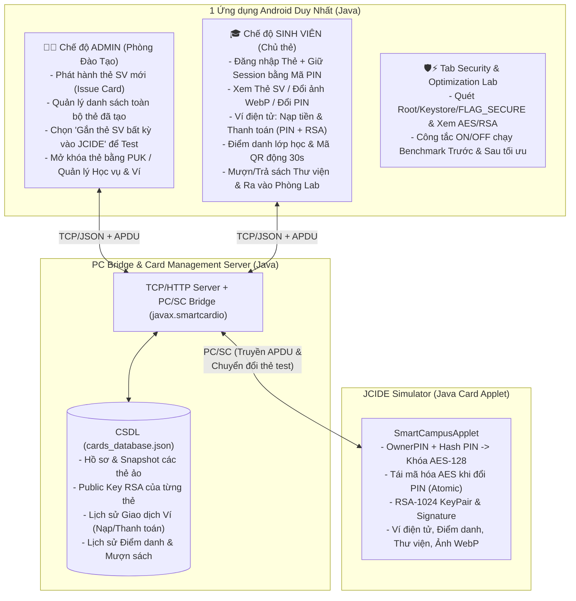

# Kế Hoạch Đồ Án Tích Hợp 3 Môn (Master Plan)
**Đề tài:** Hệ thống Quản lý & Ứng dụng Thẻ Sinh Viên Thông Minh Đa Năng (*Smart Student ID*)  
**Ngôn ngữ & Công cụ:** 1 App Android duy nhất (Java - tích hợp 2 vai trò Admin & Sinh viên) + Java Card (JCIDE Simulator) + PC Bridge & Card Management Server

---

## 1. Kiến trúc tổng thể hệ thống (System Architecture)

Hệ thống chỉ sử dụng **1 App Android duy nhất** (phân quyền 2 chế độ: **Admin - Phòng Đào tạo** và **Sinh viên - Chủ thẻ**) kết nối trực tiếp với **JCIDE Simulator** thông qua **SmartCard Bridge & Management Server** kèm **CSDL** trên máy tính.

---

## 2. Chi tiết 7 Phân hệ chức năng của Hệ thống

### 2.1. Phân hệ Quản trị Thẻ (Role Admin ngay trên App Android)
1. **Phát hành Thẻ Sinh Viên mới (`Issue New Card`):**
   - Nhập MSSV, Họ tên, Ngày sinh, Quê quán/Lớp, Khoa/Mã thẻ, Ảnh chân dung, PIN mặc định, Số dư ví khởi tạo.
   - Gửi lệnh xuống thẻ JCIDE để **băm mã PIN sinh khóa AES-128**, mã hóa thông tin lưu vào EEPROM, đồng thời yêu cầu thẻ **sinh cặp khóa RSA-1024 mới** ngay trên chip.
   - Thu thập `Public Key RSA (Modulus N, Exponent E)` từ thẻ gửi về lưu vào **CSDL** (để dùng đối chiếu chữ ký khi nạp tiền, thanh toán, điểm danh hoặc mượn sách).
2. **Quản lý Danh sách Thẻ & Chuyển đổi Thẻ ảo để Test (`Virtual Card Switcher`):**
   - Xem toàn bộ các thẻ sinh viên đã tạo trong CSDL.
   - Bấm nút **"Gắn thẻ này vào đầu đọc (Activate Card)"** để nạp trạng thái thẻ của sinh viên đó vào JCIDE, giúp test nhiều thẻ sinh viên khác nhau cực kỳ dễ dàng.
3. **Mở khóa thẻ bằng mã PUK & Quản lý Học vụ / Tài chính:**
   - Mở khóa cho thẻ bị khóa PIN (do nhập sai 3 lần) bằng mã **PUK (8 số)**.
   - Xem lịch sử nạp tiền/thanh toán, danh sách điểm danh ca học và danh sách sách thư viện đang mượn.

### 2.2. Phân hệ Xác thực Mã PIN, Mã hóa PIN & Dẫn xuất Khóa AES từ PIN (Trọng tâm Smart Card)
1. **Cơ chế Xác thực PIN & Giới hạn số lần nhập sai:**
   - Sử dụng `OwnerPIN` kết hợp lưu giá trị băm của mã PIN trên thẻ, giới hạn tối đa **3 lần nhập sai** (`0x63C2` $\rightarrow$ `0x63C1` $\rightarrow$ `0x6983` khóa thẻ).
2. **Sinh khóa AES-128 trực tiếp từ Mã PIN (`PIN-derived AES Key`):**
   - Đáp ứng yêu cầu: *"Các thông tin trước khi lưu phải được mã hóa (sử dụng AES với khóa được tạo ra từ mã PIN)"*.
   - Khi khởi tạo hoặc xác thực mã PIN, Applet dùng thuật toán băm trên thẻ (`MessageDigest.ALG_MD5` hoặc `ALG_SHA` cắt 16 bytes) để băm mã PIN thành khóa bí mật `AESKey (128-bit)` nạp vào `aesKey.setKey(...)`.
3. **Cơ chế Đổi Mã PIN & Tái mã hóa thông tin (`Atomic Re-encryption on PIN Change`):**
   - Khi người dùng đổi từ `PIN cũ` sang `PIN mới` (`INS_CHANGE_PIN = 0x11`):
     1. Kiểm tra `PIN cũ` hợp lệ.
     2. Dùng `Khóa AES cũ` (tạo từ `PIN cũ`) giải mã toàn bộ thông tin cá nhân đang lưu trong EEPROM (`encryptedStudentInfo`) ra bộ nhớ đệm RAM (`transientBuffer`).
     3. Băm `PIN mới` để sinh ra `Khóa AES mới` và cập nhật mã PIN đã mã hóa/băm.
     4. Dùng `Khóa AES mới` mã hóa lại dữ liệu trong `transientBuffer` và ghi đè vào `encryptedStudentInfo` bên trong giao dịch nguyên tử (`JCSystem.beginTransaction()` / `commitTransaction()`), sau đó xóa sạch RAM.
4. **Quản lý Session bằng Mã PIN trên App Android:**
   - Lần đầu quét thẻ + xác thực RSA Challenge-Response + nhập PIN.
   - Các lần mở App tiếp theo giữ Session bằng khóa dẫn xuất `PBKDF2WithHmacSHA256` + `AndroidKeyStore`; nhập sai quá 3 lần tự động `Auto-Wipe` xóa sạch Session.

### 2.3. Phân hệ Hồ sơ Thẻ Sinh Viên & Lưu Ảnh trên Thẻ (Tab 1: "Thẻ Sinh Viên")
- Hiển thị trực quan mặt thẻ sinh viên: Ảnh chân dung, MSSV, Họ tên, Ngày sinh, Quê quán/Lớp, Khoa/Mã BHYT, Số dư ví, Điểm rèn luyện.
- **Lưu & Thay đổi thông tin cá nhân:** Toàn bộ chuỗi thông tin định danh trước khi lưu vào EEPROM đều được đệm `PKCS#7` và mã hóa **AES-128 CBC** bằng khóa dẫn xuất từ mã PIN (`INS_SET_STUDENT_INFO = 0x20`, `INS_GET_STUDENT_INFO = 0x21`).
- **Lưu & Đổi ảnh chủ thẻ:** Tự động **Resize (150x150px) & Nén sang chuẩn WebP (~3.5KB)** $\rightarrow$ Chia thành các gói Chunk APDU ghi/đọc trên EEPROM của thẻ (`INS_UPLOAD_AVATAR_CHUNK = 0x22`, `INS_DOWNLOAD_AVATAR_CHUNK = 0x23`).

### 2.4. Phân hệ Ví Điện Tử: Nạp tiền & Thanh toán Xác thực PIN + RSA (Bổ sung theo yêu cầu Đề tài)
- Đáp ứng yêu cầu bắt buộc trong đề: *"Có chức năng nạp tiền, thanh toán... Mỗi lần thanh toán, nạp tiền, yêu cầu cần phải xác thực bằng mã PIN và sử dụng mật mã khóa công khai (RSA hoặc ECC)"*.
- **Lưu trữ Số dư trên thẻ (`On-Card Balance`):**
  - Lưu số dư ví sinh viên (đơn vị: VNĐ hoặc Nghìn VNĐ) trong EEPROM của thẻ, được bảo vệ bằng giao dịch nguyên tử (`JCSystem.beginTransaction`) và mã hóa cùng hồ sơ thẻ.
- **Quy trình Nạp tiền (`INS_WALLET_CREDIT = 0x40`) & Thanh toán học phí / căng-tin / viện phí (`INS_WALLET_DEBIT = 0x41`):**
  1. **Bước 1 – Xác thực mã PIN:** Yêu cầu người dùng nhập mã PIN và gửi lệnh `VERIFY_PIN (0x10)` xuống thẻ (`requirePinValidated()`).
  2. **Bước 2 – Ký số RSA trên thẻ & Cập nhật số dư nguyên tử:**
     - Phần mềm gửi gói dữ liệu giao dịch gồm: `[Loại GD (Nạp/Thanh toán) + Số tiền + Mã giao dịch/Timestamp (Challenge Nonce)]` xuống thẻ.
     - Nếu là Thanh toán, thẻ kiểm tra `Số dư hiện tại >= Số tiền thanh toán` (nếu không đủ trả về lỗi `SW_CONDITIONS_NOT_SATISFIED = 0x6985`).
     - Thẻ cập nhật số dư trong khối `JCSystem.beginTransaction() ... commitTransaction()`, ghi vào Nhật ký vòng trên thẻ, đồng thời dùng **`Private Key RSA-1024`** ký lên gói `[Loại GD + Số tiền + Số dư mới + Nonce]` và trả chữ ký về cho phần mềm.
  3. **Bước 3 – Xác thực chữ ký bằng `Public Key RSA` & Lưu CSDL:**
     - Phần mềm trên máy tính / Server lấy `Public Key RSA` của thẻ trong CSDL để `Verify` chữ ký số trả về.
     - Chỉ khi chữ ký RSA hợp lệ 100%, hệ thống mới ghi nhận giao dịch Nạp tiền / Thanh toán thành công vào bảng `wallet_transactions` trong CSDL.

### 2.5. Phân hệ Điểm danh Lớp học & Mã QR Định danh Động (Tab 2: "Điểm danh")
- **Quẹt thẻ Điểm danh lớp học:** Chọn ca học $\rightarrow$ Bấm điểm danh $\rightarrow$ Thẻ dùng `Private Key RSA-1024` ký lên gói `(MSSV + Mã môn + Timestamp)` $\rightarrow$ Server đối chiếu với `Public Key` của sinh viên đó để ghi nhận điểm danh vào CSDL (chống điểm danh hộ bằng thẻ giả).
- **Mã QR Định danh Động (Đổi mỗi 30 giây):** Tạo mã QR đính kèm `Timestamp + Chữ ký RSA` tự đổi mới mỗi 30 giây kết hợp bật cờ `FLAG_SECURE` chống chụp màn hình.

### 2.6. Phân hệ Thư viện & Kiểm soát Ra vào Phòng Lab (Tab 3: "Thư viện & Lab")
- **Mượn / Trả sách Thư viện:** Ghi trực tiếp mã sách đang mượn vào EEPROM của thẻ bằng cơ chế **Giao dịch nguyên tử (`JCSystem.beginTransaction` / `commitTransaction`)** chống lỗi dữ liệu khi rút thẻ đột ngột.
- **Kiểm soát Ra vào Phòng Lab & Nhật ký hoạt động:** Kiểm tra quyền mở cửa phòng Lab và đọc **10 hoạt động gần nhất** (bao gồm cả Nạp tiền, Thanh toán, Điểm danh, Mượn/Trả sách) lưu trong mảng vòng (`Circular Buffer`) ngay trên chip thẻ.

### 2.7. Phân hệ Bảo vệ Đồ án (Tab 4: "Security & Optimization Lab")
- **Bảng kiểm tra Bảo mật:** Quét Root/Emulator/Debugger, kiểm tra `AndroidKeyStore`, `FLAG_SECURE`, xem trực tiếp gói lệnh Raw APDU và đối chiếu bản mã **AES-128 Ciphertext (khóa sinh từ PIN)** trên thẻ với bản rõ.
- **Bảng đo kiểm Tối ưu hóa:** Công tắc bật/tắt `Optimized Mode` và nút bấm **Chạy Benchmark** đo trực tiếp: Truyền ảnh (*PNG gốc vs WebP nén*), Đa luồng (*Main Thread vs ExecutorService 60 FPS*), và Đọc dữ liệu (*APDU trực tiếp vs Local Encrypted Cache*).

---

## 3. Danh sách Tập lệnh APDU Chuẩn hóa (`CLA = 0x80`)

| INS | Tên lệnh | Tham số `P1` / `P2` | Dữ liệu gửi (`CDATA`) | Dữ liệu nhận & Xử lý trên Thẻ |
| :---: | :--- | :--- | :--- | :--- |
| `0x10` | `INS_VERIFY_PIN` | `0x00`, `0x00` | Mã PIN (4–8 bytes) | Kiểm tra PIN (tối đa 3 lần sai), dẫn xuất khóa AES từ PIN. Trả về `9000`, `63CX` hoặc `6983`. |
| `0x11` | `INS_CHANGE_PIN` | `0x00`, `0x00` | `[LenOld][OldPIN][LenNew][NewPIN]` | Giải mã dữ liệu bằng khóa AES từ PIN cũ $\rightarrow$ Đổi PIN & tạo khóa AES từ PIN mới $\rightarrow$ Tái mã hóa dữ liệu (Atomic). |
| `0x12` | `INS_UNBLOCK_CARD_PUK` | `0x00`, `0x00` | Mã PUK Admin (8 bytes) | Mở khóa thẻ, khôi phục PIN mặc định và tái mã hóa dữ liệu theo PIN mặc định. |
| `0x13` | `INS_GET_PUBLIC_KEY` | `P1=00`: Gen mới + Lấy N `P1=01`: Lấy Modulus N `P1=02`: Lấy Exponent E | Rỗng | Sinh cặp khóa `RSA-1024` trên thẻ và xuất khóa công khai `(N, E)`. |
| `0x14` | `INS_SIGN_CHALLENGE` | `0x00`, `0x00` | Chuỗi `Challenge Nonce` | Ký số `SHA1withRSA` bằng `Private Key` trên thẻ để xác thực thẻ thật. |
| `0x20` | `INS_SET_STUDENT_INFO` | `0x00`, `0x00` | Chuỗi UTF-8 thông tin chủ thẻ | Yêu cầu đã xác thực PIN. Đệm `PKCS#7` và mã hóa `AES-128 CBC` bằng khóa sinh từ PIN lưu vào EEPROM. |
| `0x21` | `INS_GET_STUDENT_INFO` | `P1=00`: Bản rõ đã giải mã `P1=01`: Bản mã AES thô | Rỗng | Giải mã `AES-128 CBC` bằng khóa từ PIN và trả về thông tin chủ thẻ (hoặc trả bản mã để kiểm chứng). |
| `0x22` | `INS_UPLOAD_AVATAR_CHUNK`| `P1-P2`: Offset (2 bytes) | Dữ liệu mảnh ảnh WebP | Ghi từng phân mảnh ảnh chủ thẻ vào mảng `avatarBuffer` trong EEPROM. |
| `0x23` | `INS_DOWNLOAD_AVATAR_CHUNK`| `P1-P2`: Offset (2 bytes) | Rỗng | Đọc từng phân mảnh ảnh chủ thẻ (tối đa 240 bytes/gói) từ EEPROM. |
| `0x30` | `INS_GET_ACADEMIC_LIBRARY_STATUS`| `0x00`, `0x00` | Rỗng | Trả về Điểm rèn luyện, Số buổi điểm danh, Quyền Lab, Số sách đang mượn và Số dư Ví. |
| `0x31` | `INS_BORROW_OR_ATTENDANCE`| `P1=01`: Điểm danh `P1=02`: Mượn sách | `[Mã Môn/Sách 2B][Timestamp 4B]` | Cập nhật trạng thái trong `Transaction` + Ký số `RSA-1024` lên dữ liệu giao dịch. |
| `0x32` | `INS_RETURN_OR_LAB_ACCESS`| `P1=01`: Trả sách `P1=02`: Vào phòng Lab | `[Mã Sách/Lab 2B][Timestamp 4B]` | Cập nhật trả sách / kiểm tra quyền Lab trong `Transaction` + Ký số `RSA-1024`. |
| `0x33` | `INS_GET_ACTIVITY_LOG` | `0x00`, `0x00` | Rỗng | Đọc 10 hoạt động gần nhất từ bộ nhớ đệm vòng (`Circular Buffer`) trên thẻ. |
| `0x40` | `INS_WALLET_CREDIT` *(Mới)*| `0x00`, `0x00` | `[Số tiền nạp 4B][Nonce/Time 4B]` | **Nạp tiền:** Yêu cầu đã xác thực PIN $\rightarrow$ Cộng số dư (Atomic) $\rightarrow$ Ký số `RSA-1024` lên `[Loại GD + Số tiền + Số dư mới + Nonce]`. |
| `0x41` | `INS_WALLET_DEBIT` *(Mới)* | `0x00`, `0x00` | `[Số tiền trừ 4B][Nonce/Time 4B]` | **Thanh toán:** Yêu cầu đã xác thực PIN & đủ số dư $\rightarrow$ Trừ số dư (Atomic) $\rightarrow$ Ký số `RSA-1024` lên biên lai giao dịch. |
| `0x42` | `INS_WALLET_GET_BALANCE` *(Mới)*| `0x00`, `0x00` | Rỗng | Yêu cầu đã xác thực PIN $\rightarrow$ Trả về số dư hiện tại của ví trên thẻ (4 bytes). |

---

## 4. Lộ trình Thực hiện theo 3 Mốc Báo Cáo Môn Smart Card (2026)

### 🚩 MỐC 1 (30/11/2026) – Giao diện Máy tính, Ý tưởng, Mã PIN & Lưu thông tin cơ bản
* **Yêu cầu tối thiểu của giảng viên:**
  - [x] Lên được ý tưởng chung cho bài toán, mô tả rõ ràng, chi tiết các chức năng.
  - [x] Tạo mã PIN, thay đổi, kiểm tra mã PIN, có cơ chế giới hạn số lần nhập sai (3 lần khóa thẻ + mở khóa bằng PUK).
  - [x] Triển khai lưu thông tin cá nhân + ảnh lên thẻ và thay đổi thông tin.
  - [ ] **Cần hoàn thiện thêm cho Mốc 1:** Tích hợp giao diện điều khiển trực tiếp trên máy tính (`PC Web/Desktop Dashboard` chạy tại `http://localhost:8080`) để demo trực tiếp trên PC bên cạnh App Android.

### 🚩 MỐC 2 (14/12/2026) – Mã hóa AES (Khóa từ PIN), Xác thực RSA & Nạp tiền/Thanh toán
* **Yêu cầu tối thiểu của giảng viên:**
  - [ ] **Nâng cấp AES & Mã hóa PIN:** Chuyển cơ chế khóa AES từ khóa cố định sang **khóa AES-128 dẫn xuất từ mã PIN** (băm mã PIN bằng `MessageDigest` trên thẻ) + **Tái mã hóa thông tin cá nhân khi đổi mã PIN**.
  - [x] Tạo cặp khóa `RSA-1024` trên thẻ và xác thực thẻ bằng mật mã khóa công khai RSA (`Challenge-Response`).
  - [ ] **Bổ sung Nghiệp vụ Nạp tiền & Thanh toán (`INS 0x40`, `0x41`, `0x42`):** Mỗi lần nạp tiền hoặc thanh toán đều bắt buộc xác thực bằng mã PIN và ký/xác thực bằng cặp khóa RSA.

### 🚩 MỐC 3 (Dự kiến 28/12/2026) – Hoàn thiện CSDL, Báo cáo Cuối kỳ & Vấn đáp
* **Yêu cầu tối thiểu của giảng viên:**
  - [ ] **Hoàn thiện CSDL trên máy tính:** Bổ sung lưu trữ **SQLite Database** (`smartcard.db`) song song với `cards_database.json` trên `BridgeServer` (gồm các bảng: `cards`, `wallet_transactions`, `attendance_logs`, `book_loans`).
  - [ ] **Hoàn thiện Hồ sơ nộp bản mềm (trước ngày báo cáo 2 ngày):**
    - Quy tắc đặt tên file bắt buộc: `Tên lớp tín chỉ_Tên nhóm_Tên đề tài` (Ví dụ: `L01_Nhóm 1_Thẻ sinh viên thông minh`).
    - **Báo cáo Word (tối thiểu 30 trang A4):** Chỉ gồm **2 Chương** (*Chương 1: Mô tả bài toán & Phân tích thiết kế hệ thống*; *Chương 2: Cài đặt và Thực nghiệm* – Lưu ý: **Bỏ qua chương Cơ sở lý thuyết** theo đúng yêu cầu của cô).
    - **Slide thuyết trình PowerPoint** + **Video Demo các chức năng** + **Bảng phân công công việc & Điểm dự kiến**.

---

## 5. Checklist Đối chiếu Thang điểm Chấm Đồ án (10 Điểm)

1. **Báo cáo bản Word (0.5 điểm):** Đủ $\ge 30$ trang A4, đúng cấu trúc 2 chương (Phân tích thiết kế & Cài đặt thực nghiệm), đặt tên file đúng chuẩn.
2. **Khả năng thuyết trình (0.5 điểm):** Slide rõ ràng, luồng demo mạch lạc.
3. **Nội dung Project (5.0 điểm):**
   - [x] **Giao diện đẹp (0.5 điểm):** Có cả App Android hiện đại và Giao diện Quản lý Thẻ trên Máy tính (PC Dashboard).
   - [x] **Khởi tạo thẻ (0.5 điểm):** Khởi tạo thông tin chủ thẻ, ảnh, mã PIN, số dư, sinh khóa RSA.
   - [x] **Thay đổi thông tin cá nhân (0.5 điểm):** Cập nhật thông tin chữ và đổi ảnh chân dung trên thẻ.
   - [ ] **Mã hóa được thông tin (1.0 điểm):** Mã hóa AES-128 trên thẻ với **khóa được tạo ra từ mã PIN**.
   - [ ] **Thay đổi mã PIN, mã hóa mã PIN (0.5 điểm):** Băm mã PIN, đổi mã PIN và tái mã hóa lại dữ liệu thẻ theo khóa AES của PIN mới.
   - [x] **Tạo được cặp khóa RSA (0.5 điểm):** Sinh cặp khóa `RSA-1024` ngay trên chip thẻ và xuất `Public Key (Modulus N, Exponent E)`.
   - [ ] **Xác thực được theo chức năng (0.5 điểm):** Xác thực PIN + Ký số & Kiểm tra chữ ký RSA khi **Nạp tiền, Thanh toán**, Điểm danh, Mượn sách.
   - [ ] **Có CSDL (0.5 điểm):** Lưu trữ thông tin thẻ, `Public Key RSA`, số dư và lịch sử giao dịch vào CSDL trên máy tính.
   - [x] **Có demo chức năng (0.5 điểm):** Demo trực tiếp đầy đủ các luồng trên JCIDE Simulator + PC + Android.
4. **Trả lời câu hỏi Vấn đáp (4.0 điểm – Điểm liệt nếu không trả lời được):**
   - Nắm vững cấu trúc gói tin `Command APDU (CLA, INS, P1, P2, Lc, Data, Le)` và `Response APDU (Data, SW1, SW2)`.
   - Giải thích rõ quy trình **sinh khóa AES từ mã PIN** và **xử lý khối dữ liệu đã mã hóa khi người dùng đổi mã PIN**.
   - Giải thích rõ quy trình **xác thực RSA (Challenge-Response)** khi nạp tiền/thanh toán: Khóa nào lưu trên thẻ (`Private Key`), khóa nào lưu ở CSDL máy tính (`Public Key`), ký dữ liệu gì để chống phát lại (`Replay Attack`).
   - Giải thích cách chia nhỏ mảng byte (`Chunking` qua `P1, P2` offset) khi truyền ảnh xuống thẻ vượt quá giới hạn 255 bytes của chuẩn APDU ngắn.

