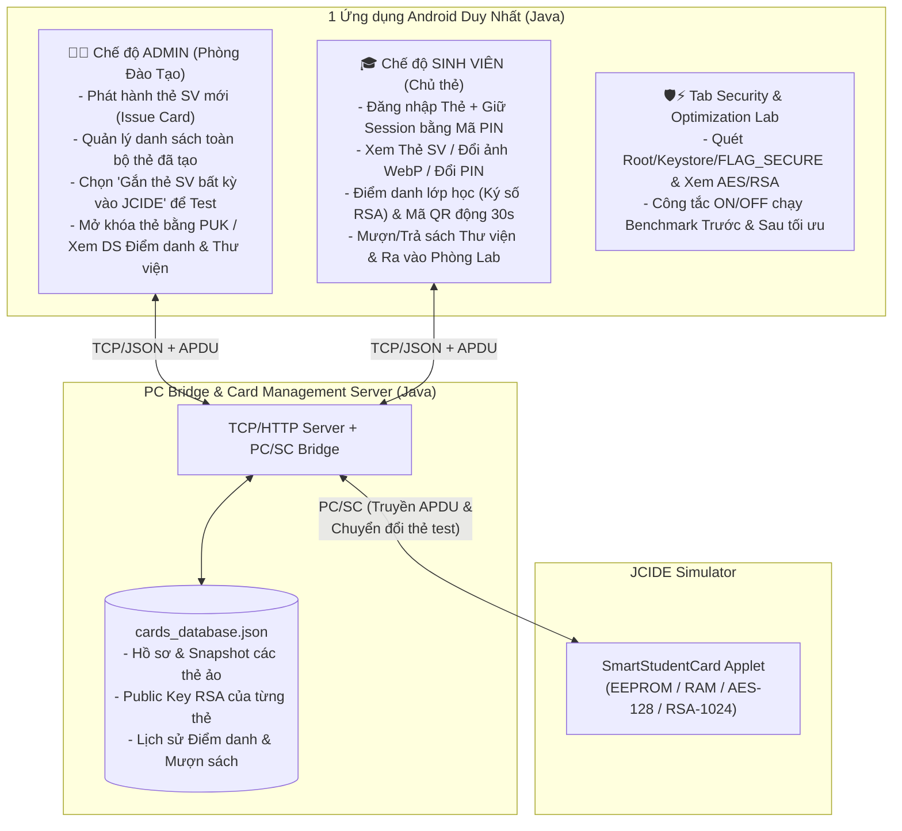

# Kế Hoạch Đồ Án Tích Hợp 3 Môn (Master Plan)
**Đề tài:** Hệ thống Quản lý & Ứng dụng Thẻ Sinh Viên Thông Minh Đa Năng (*Smart Student ID*)  
**Ngôn ngữ & Công cụ:** 1 App Android (Java - tích hợp 2 vai trò Admin & Sinh viên) + Java Card (JCIDE Simulator) + PC Bridge & Card Management Server

---

## 1. Kiến trúc tổng thể hệ thống (System Architecture)

Hệ thống chỉ sử dụng **1 App Android duy nhất** (phân quyền 2 chế độ: **Admin - Phòng Đào tạo** và **Sinh viên - Chủ thẻ**) kết nối với **JCIDE Simulator** thông qua **SmartCard Bridge & Management Server** trên máy tính.

---

## 2. Chi tiết 6 Phân hệ chức năng của Hệ thống

### 2.1. Phân hệ Quản trị Thẻ (Role Admin ngay trên App)
1. **Phát hành Thẻ Sinh Viên mới (`Issue New Card`):**
   - Nhập MSSV, Họ tên, Ngày sinh, Lớp, Khoa, Ảnh chân dung, PIN mặc định.
   - Gửi lệnh xuống thẻ JCIDE để mã hóa **AES-128** lưu vào EEPROM, đồng thời yêu cầu thẻ sinh cặp khóa **RSA-1024** mới.
   - Thu thập `Public Key RSA (Modulus N, Exponent E)` từ thẻ gửi về lưu trên Server Database (để dùng đối chiếu chữ ký khi sinh viên điểm danh hoặc mượn sách).
2. **Quản lý Danh sách Thẻ & Chuyển đổi Thẻ ảo để Test (`Virtual Card Switcher`):**
   - Xem toàn bộ các thẻ sinh viên đã tạo (VD: *SV1 - Vũ Ngọc Hải*, *SV2 - Nguyễn Văn A*, *SV3 - Trần Thị B*).
   - Bấm nút **"Gắn thẻ này vào đầu đọc (Activate Card)"** để nạp trạng thái thẻ của sinh viên đó vào JCIDE, giúp test nhiều thẻ sinh viên khác nhau cực kỳ dễ dàng.
3. **Mở khóa thẻ bằng mã PUK & Quản lý Học vụ:**
   - Mở khóa cho thẻ bị khóa PIN (do sinh viên nhập sai 3 lần) bằng mã **PUK (8 số)**.
   - Xem danh sách sinh viên đã điểm danh các ca học và danh sách sách thư viện đang được mượn.

### 2.2. Phân hệ Đăng nhập & Quản lý Session bằng Mã PIN (Role Sinh viên)
1. **Đăng nhập lần đầu (Quét thẻ + Xác thực RSA + Nhập PIN):**
   - Kết nối thẻ đang gắn trên JCIDE -> App gửi chuỗi ngẫu nhiên `Nonce` (16 bytes) yêu cầu thẻ ký bằng `Private Key RSA-1024` để chống thẻ giả -> Nhập mã PIN (6 số) để mở thẻ và lưu Session xuống máy.
2. **Mở khóa các lần tiếp theo (Giữ Session - Chỉ nhập Mã PIN):**
   - Khi đóng App mở lại: **Không cần quét lại thẻ**. App hiện màn hình *"Xin chào [Tên SV] - Nhập mã PIN để mở khóa"*.
   - Nhập đúng PIN -> Dùng khóa dẫn xuất từ PIN (`PBKDF2WithHmacSHA256` + `AndroidKeyStore`) giải mã dữ liệu Cache mở thẳng vào trang chủ trong `~15ms` và tự động `Verify PIN` ngầm với thẻ.
   - **Bảo mật vật lý:** Nếu người lạ cầm máy nhập sai PIN quá 3 lần -> Tự động xóa sạch Session (`Auto-Wipe`) và bắt quét thẻ lại từ đầu.

### 2.3. Phân hệ Hồ sơ Thẻ Sinh Viên (Tab 1: "Thẻ Sinh Viên")
- Hiển thị trực quan mặt thẻ sinh viên: Ảnh chân dung, MSSV, Họ tên, Ngày sinh, Lớp, Khoa, Điểm rèn luyện.
- Cập nhật thông tin sinh viên (tự động mã hóa **AES-128** trong EEPROM của thẻ).
- **Đổi ảnh thẻ sinh viên:** Tự động **Resize (150x150px) & Nén sang chuẩn WebP (~3.5KB)** -> Chia thành các gói Chunk APDU ghi xuống thẻ.
- Đổi mã PIN thẻ trực tiếp.

### 2.4. Phân hệ Điểm danh Lớp học & Mã QR Định danh Động (Tab 2: "Điểm danh")
- **Quẹt thẻ Điểm danh lớp học:** Chọn ca học -> Bấm điểm danh -> Thẻ dùng `Private Key RSA-1024` ký lên gói `(MSSV + Mã môn + Timestamp)` -> Server đối chiếu với `Public Key` của sinh viên đó để ghi nhận điểm danh (chống điểm danh hộ bằng thẻ giả).
- **Mã QR Định danh Động (Đổi mỗi 30 giây):** Tạo mã QR đính kèm `Timestamp + Chữ ký RSA` tự đổi mới mỗi 30 giây kết hợp bật cờ `FLAG_SECURE` chống chụp màn hình (chống chụp ảnh QR gửi qua Zalo nhờ bạn quẹt hộ).

### 2.5. Phân hệ Thư viện & Kiểm soát Ra vào Phòng Lab (Tab 3: "Thư viện & Lab")
- **Mượn / Trả sách Thư viện:** Ghi trực tiếp mã sách đang mượn vào EEPROM của thẻ bằng cơ chế **Giao dịch nguyên tử (`JCSystem.beginTransaction` / `commitTransaction`)** chống lỗi dữ liệu khi rút thẻ đột ngột.
- **Kiểm soát Ra vào Phòng Lab & Nhật ký hoạt động:** Kiểm tra quyền mở cửa phòng Lab và đọc **10 hoạt động gần nhất** lưu trong mảng vòng (`Circular Buffer`) ngay trên chip thẻ.

### 2.6. Phân hệ Bảo vệ Đồ án (Tab 4: "Security & Optimization Lab")
- **Bảng kiểm tra Bảo mật:** Quét Root/Emulator/Debugger, kiểm tra `AndroidKeyStore`, `FLAG_SECURE`, xem trực tiếp gói lệnh Raw APDU và đối chiếu bản mã **AES-128 Ciphertext** trên thẻ với bản rõ.
- **Bảng đo kiểm Tối ưu hóa:** Công tắc bật/tắt `Optimized Mode` và nút bấm **Chạy Benchmark** đo trực tiếp: Truyền ảnh (*PNG gốc vs WebP nén*), Đa luồng (*Main Thread vs ExecutorService 60 FPS*), và Đọc dữ liệu (*APDU trực tiếp vs Local Encrypted Cache*).
